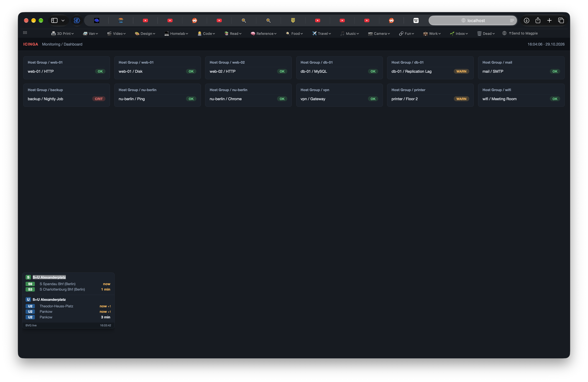

# Project Log

## Goal

A small website that can be framed into the Icinga monitoring page (displayed on a TV via Chrome on a Windows NUC) to show the next departures of Berlin S-Bahn and U-Bahn stations in the bottom-right corner — at most one S-Bahn station and one U-Bahn station, for both directions each.

## Status

**Preview complete and verified on local Mac** (2026-10-29):

Screenshot shows the Icinga stand-in dashboard with the widget pinned bottom-left, rendering real departures for S+U Alexanderplatz (S9, S3, U2, with "now"/"1 min"/"3 min" countdowns and delays).

## What was built

| File | Purpose |
|------|---------|
| `01_Project/index.html` | Dark Icinga-style stand-in dashboard (host/service cards, live clock) with the widget embedded as a fixed-position iframe, bottom-right. |
| `01_Project/departures.html` | The actual widget: one S-Bahn + one U-Bahn station, next departures for both directions (grouped by terminus), line badges, countdown, delay display (`+2` in orange). Auto-refresh every 30s. |
| `02_Design/DESIGN.md` | Berlin S-Bahn/U-Bahn design and iconography reference. |
| `03_Screenshots/docs-preview.png` | Verified screenshot of the running preview. |
| `README.md` | Run instructions, configuration reference, and the iframe embed snippet for the real Icinga page. |

## Technical decisions

- **Data source**: [BVG transport.rest API](https://v6.bvg.transport.rest/) (`v6.bvg.transport.rest`), a free public instance — no API key needed, CORS-enabled, so it works from `file://` too.
  - Departures: `GET /stops/{id}/departures?results=20&suburban=true|subway=true`
  - Stop search: `GET /stops?query={name}`
  - Stop ids are BVG IBNRs (e.g. `900100003` = S+U Alexanderplatz; the `de:11000:...` form is NOT accepted by the departures endpoint — "id must be an IBNR").
- **No dependencies, no build step**: plain HTML/CSS/JS, single files. Deliberate, since the final target is a TV display that should never break.
- **Iframe embedding**: the widget is a separate document so it can be dropped into any parent page (Icinga) with one `<iframe>` tag and zero interference with the parent's CSS/JS.
- **Direction grouping**: departures are grouped by the `direction` field (terminus), up to 2 directions shown, N departures each (default 2).

## Configuration

Built-in setup panel (footer `setup` button, persisted in localStorage) or URL params on `departures.html`: `?s={S stop}&u={U stop}&r={regional stops, comma-sep.}&n={departures per direction}`. Values are station names or IBNRs. Defaults: S Humboldthain, U Voltastraße, RE block cycling S+U Gesundbrunnen/S+U Alexanderplatz, n=2. URL params override the saved panel config.

## Open items

- [x] Decide final stations — S Humboldthain, U Voltastraße, plus a regional block alternating Gesundbrunnen/Alexanderplatz (done, session 4; RE rotation updated in session 22, see open item above).
- [ ] Integrate the iframe snippet into the real Icinga page source (user will provide the source code later — session hand-off point, continue via CLI).
- [ ] Verify rendering on the TV/NUC (Chrome on Windows) — especially readability at TV distance (a `scale` config option now exists, session 9; verification still pending).
- [x] Position moved to bottom-right (user correction in session 4) — stand-in `index.html` and README snippet updated (done, session 8).
- [ ] NUC deployment: the NUC gets its own folder with only `01_Project/departures.html` (self-contained single file), not a copy of this repo; serve via a local static server, config stays in the iframe URL.
- [x] Handle Alexanderplatz in the RE rotation during the Stadtbahn regional closure (14 June – 12 December 2026, researched session 21): per user decision (session 22), the default `r` now cycles Gesundbrunnen, Charlottenburg, Ostbahnhof — the stations where regional trains actually run or terminate during the closure. Alexanderplatz returns to the rotation after 12 Dec 2026.

## Session history

1. **2026-10-29 (session 1)** — Built the preview (`index.html`, `departures.html`, `README.md`) against the live BVG API; verified API response shape via `v6.bvg.transport.rest`; JS syntax-checked with `node --check`. Repo did not exist yet.
2. **2026-10-29 (session 2)** — User created private repo `Xpycode/departure-board` via `gh repo create`; pushed initial commit `805ee85` to `main` with the three files. User confirmed the preview runs locally with live data (screenshot provided → `docs-preview.png`).
3. **2026-10-29 (session 3)** — Added this log (`PROJECT_LOG.md`) and the verified screenshot.
4. **2026-10-29 (session 4)** — New station defaults (S Humboldthain, U Voltastraße); added third "RE" block for regional trains cycling between S+U Gesundbrunnen and S+U Alexanderplatz every 20s (Stadtbahn RE construction); stop params now accept names or IBNRs (auto-resolved via `/stops?query=`); user clarified widget position is bottom-right. JS syntax-checked with `node --check`.
5. **2026-10-29 (session 5)** — Merged the two remote `vibe/*` branches (regional block, design reference) into `main` locally and pushed; BVG API endpoints re-verified live. Restructured the repo to the standard numbered folder layout: site code into `01_Project/`, design reference into `02_Design/`, screenshot into `03_Screenshots/`, this log into `docs/`; added `.gitignore`; README updated for the new paths.
6. **2026-10-29 (session 6)** — Deployment decision: the NUC will get a standalone folder with only `departures.html` (verified self-contained: no local asset references, sole runtime dependency is the BVG API), not a copy of this repo. README gained a "Deploying to the NUC" section; config stays in the iframe URL so the file can be updated by overwrite.
7. **2026-10-29 (session 7)** — Fixed station name resolution: `/stops?query=` returns only `type: "station"` entries with `de:11000:<IBNR>` ids, so the session-4 `resolveId` (looking for `type: "stop"`, passing raw ids) never resolved any name — all blocks showed API errors. Now accepts station results and extracts the bare IBNR; verified live for S Humboldthain (900008101) and U Voltastraße (900007103). Added a built-in setup panel (footer `setup` button) that saves station config to localStorage; precedence is URL params > saved config > defaults. Cancelled departures (null `when`) now fall back to `plannedWhen` instead of rendering "01:00 *". JS syntax-checked with `node --check`.
8. **2026-10-29 (session 8)** — Widget position updated to bottom-right everywhere: stand-in `index.html` iframe, README embed snippet/heading, and this log's goal description. Remaining open items are the Icinga integration (needs the real page source) and TV/NUC verification.
9. **2026-10-29 (session 9)** — Fixed the RE block's permanent HTTP 500: the query string contained a literal `®` where `&reg` belonged (`&regional=true®ionalExp=true`), so the API rejected every regional request. Verified the corrected query live (HTTP 200 for S+U Alexanderplatz; S+U Gesundbrunnen resolves to IBNR 900007102). Added a display `scale` setting (0.8–2, setup panel or `?scale=`): all widget sizes derive from a `--scale` CSS variable via calc(); the embedding iframe must be sized `340 × scale` by `300 × scale`. The stand-in `index.html` auto-sizes its iframe from the saved scale (same-origin preview only). JS syntax-checked with `node --check`.
10. **2026-10-29 (session 10)** — Auto-fit sizing: with the RE block rendering real content, the fixed `300 × scale` iframe height clipped the RE block and footer. The widget now reports its rendered size (`postMessage` type `bvg-widget-size`, after every render via a MutationObserver); the stand-in listens and resizes the frame exactly. README documents the listener snippet for the real Icinga embed plus a manual-sizing fallback (~`320 × scale`). JS syntax-checked with `node --check`.
11. **2026-10-29 (session 11)** — Two user-reported fixes: (a) scaling down left the iframe at its old size — the size report used `documentElement.scrollWidth/scrollHeight`, which never drops below the current frame size; now measures the widget element's `offsetWidth/offsetHeight`, so the frame shrinks correctly. (b) The RE block appeared to "lose connection" — it was the rotation landing on Alexanderplatz, which currently has no regional departures (construction), showing "No departures found" for a 20s slot; empty cycling stations are now skipped in favor of the next one with departures. JS syntax-checked with `node --check`.
12. **2026-10-29 (session 12)** — RE switching reworked after research (subagent + live API tests, docs at `v6.bvg.transport.rest/api.html`): the departures endpoint's default window is 10 minutes — far shorter than the 20–30+ min regional headway, the true cause of the recurring empty RE block; and its product booleans are include flags defaulting to true, so the old `regional=true&...` params never filtered (no `regionalExp`/`national` params exist on this instance). Queries now filter server-side by exclusion (`subway=false&bus=false&...`) with `duration=90` for RE and `duration=30` for S/U (verified: 16 regional at Gesundbrunnen, 19 S at Humboldthain, 12 U at Voltastraße). Rotation moved to a single 1-second ticker with a visible countdown in the RE header ("→ next station · N s"); empty-state text now names the window ("No departures in the next 90 min") and station names fall back to the configured stop instead of "Station". Rate limit 100 req/min; our polling uses ~6. JS syntax-checked with `node --check`.
13. **2026-10-29 (session 13)** — RE catchability: added `rl` (lead time per RE station, default 10 min — hides trains leaving sooner than the walk to that station; single value applies to all, comma list aligns with `r`) and `rf` (optional RE line filter, substring match, e.g. `RE,ICE`). Both in the setup panel and as URL params; the skip-empty check uses the same lead/line filtering as the display. Setup panel switched from overlay to flow layout so the auto-fit frame grows with the (now larger) panel. JS syntax-checked with `node --check`.
14. **2026-10-29 (session 14)** — Lead times for the S/U blocks too: `sl` (default 8 min, S Humboldthain) and `ul` (default 12 min, U Voltastraße), user walk times 5–8 and 9–12 minutes. Same mechanism as `rl`: hides departures leaving sooner than the walk; measured against actual (delayed) departure times; setup panel fields + URL params. Defaults assumed in station order — user can correct per station in the panel. JS syntax-checked with `node --check`.
15. **2026-10-29 (session 15)** — Info line: the departures endpoint provides typed `remarks` per departure; `type:"warning"` entries carry system disruption texts (verified live: e.g. "Die Züge der Linie RE5 fallen vom 30.10. bis 06.11. … aus und werden … ersetzt", currently 2 unique warnings at Gesundbrunnen). The widget now collects the union of warnings across all displayed trains and scrolls them in a yellow marquee line above the footer (like real station boards, "+++" separators, duration scaled to message length); hidden when there are none. Queries pass `remarks=true` explicitly. JS syntax-checked with `node --check`.
16. **2026-10-29 (session 16)** — Info line refinements: clicking the line cycles scroll speed (1x → 2x → 4x, transient), and its text size is configurable (`ts`, 8–18 px, default 12, scaled by the display scale) — setup panel field + URL param. JS syntax-checked with `node --check`.
17. **2026-10-29 (session 17)** — Info line reworked: (a) some API warnings are bare HTML link elements (`<a href="…">Informationen</a>`), which showed as raw markup — remark texts are now flattened (`stripHtml`: anchors → "label: URL", other tags stripped); (b) the ticker DOM was rebuilt on every render, restarting the scroll on each RE station switch — now rebuilt only when the message list changes, keeping the current message's scroll running; (c) discrete message model: one Meldung at a time with a position counter ("2/5"), click the counter to jump to the next message, a completed scroll pass auto-advances, click on the text keeps the speed cycle. Message source remains the per-departure warning remarks of the three blocks' fetched departures (no separate feed exists on the BVG API). JS syntax-checked with `node --check`.
18. **2026-10-29 (session 18)** — Ticker continuity: list changes (RE station switches bring different warnings) still rebuilt the ticker mid-pass, visibly restarting the scroll and blanking the line. Updates are now deferred to the end of the current scroll pass (the moment the text has just exited left), where a swap is invisible; empty lists also hide at pass end. Size reports deduped — postMessage to the parent only fires when the widget size actually changed, so routine renders never touch the frame. JS syntax-checked with `node --check`.
19. **2026-10-29 (session 19)** — "No switch" fix: with Alexanderplatz empty (verified: 0 regional departures even in a 90-min window), every rotation attempted it, skipped back, and immediately counted down to it again — no visible switch plus a doubling of fetches. Empty cycling stations were benched for 10 minutes; rotation advanced only among eligible stations, countdown hid while only one station had departures. JS syntax-checked with `node --check`.
20. **2026-10-29 (session 20)** — Per user decision: no benching. The RE fetch window was widened to 4 hours (later trains show, e.g. "19:45 *"), the rotation now gives every configured station its 20-second slot unconditionally, and a station with no departures in the window displays that honestly ("No departures in the next 4 h") for its slot. Benching machinery (`EMPTY_RETRY_MS`, `emptyUntil`, `nextEligibleIndex`, `hasRegionalDepartures`, skip-on-empty) removed. Note: verified live that Alexanderplatz currently has 0 regional departures even in a 16-hour window, so its slot will show the honest empty state until construction ends. JS syntax-checked with `node --check`.
21. **2026-10-29 (session 21)** — Research: why Alexanderplatz has no regional trains. The Berlin Stadtbahn is **completely closed to regional and long-distance traffic from 14 June to 12 December 2026** for major track works (Charlottenburg–Ostbahnhof); only the S-Bahn runs on the Stadtbahn, RE/RB lines mostly terminate at Charlottenburg or Ostbahnhof (sources: vbb.de "Stadtbahnsperrung 2026", dbregio-berlin-brandenburg.de). Regional traffic has shifted to the north ring — hence Gesundbrunnen's active RE/ICE/EC departures. Separately, Alexanderplatz station itself is being core-renovated from early 2026 to mid-2029 (DB, ~70 M€; retail cleared), but that does not suspend S-Bahn service. Matches the API observation (0 regional departures at 900100003 in a 16-hour window). No code changes; how the widget should handle the Alexanderplatz slot until 12 Dec 2026 is logged as an open item for the next session.
22. **2026-10-29 (session 22)** — Per user decision, the RE rotation for the closure period: default `r` is now `S+U Gesundbrunnen,S Charlottenburg,S Ostbahnhof` (verified live: 20 regional departures at Charlottenburg — RE1/RB21/RE7 westbound, 14 at Ostbahnhof — RE1/RE7 eastbound, 0 at Alexanderplatz). IBNRs: S Charlottenburg 900024101, S Ostbahnhof 900120005 (name resolution also works). Setup-panel placeholder and README updated; the open item is resolved — Alexanderplatz can return to `r` after 12 Dec 2026. JS syntax-checked with `node --check`.
23. **2026-10-29 (session 23)** — User confirmed the three-station RE switching works and configured the stations by hand (setup panel). Verified on the Mac preview; TV/NUC readability check remains open.
24. **2026-10-29 (session 24)** — Spec for widget v2 written (`specs/widget-v2.md`, status Review) after research via two agents: one verified the BVG API live (platform field 100% present at all five stops, platform changes only at RE stops in practice, FK bicycle hint confirmed, cancel/platform-change status remark codes observed, `/journeys` works but parked, occupancy U8-only and undocumented, rate limit 100 req/min vs our ~7, API serves `stale-if-error=30` so the widget needs its own last-good cache), one researched display conventions (DAISY/National Rail board grammar, GTFS 15-min staleness threshold, kiosk tab-crash mitigations via scheduled reload + heartbeat watchdog, WCAG measurements of the current palette — S-green badge fails AA at 4.28:1, ~16 px text minimum at 3 m TV distance). v2 scope: platform column, catchable-train highlight, cancellation rendering, platform-change emphasis, bike hint icons, clock/date header, offline/stale fallback with status dot, scheduled self-reload, parent heartbeat watchdog, S badge contrast fix. Out of scope: bus block, journeys line, occupancy, blinking. Awaiting user review before implementation planning.
25. **2026-10-29 (session 25)** — User approved the spec with defaults; widget v2 implemented per `specs/widget-v2.md` (all ten capabilities): platform column (`platform` → `plannedPlatform` → empty, changed platforms in warn orange, detected via platformChange remark or field comparison), catchable-train highlight (first non-cancelled departure per direction: orange accent bar, bold, `»`; later rows dimmed), cancelled trains struck-through with "fällt aus" (status remark codes, not `when === null`), bike hint icons (FK/gy → SVG, hover title), clock/date header (HH:MM, no seconds, text-node-only ticking), offline fallback (per-stop last-good cache so the RE rotation never cross-contaminates stations, dimmed stale render with "Offline — times as of HH:MM" banner, green/amber/red status dot, footer stamp only on successful fetches), 4-hour self-reload, guaranteed size report per 30 s cycle as heartbeat; stand-in `index.html` and the README listener snippet gained the 3-minute watchdog force-reload; S badge green darkened to #007a41 (WCAG AA); README documents the new behavior and recommends scale 1.5 for TV distance. Verified: `node --check` plus a DOM-stub harness in Node running the actual widget script against the live API — rendered rows show platform cells (incl. one `changed` on RE3: planned 6 → actual 5), `»` catchable rows, dimmed later rows, bike icons, green dot, clock. JS syntax-checked with `node --check`.
